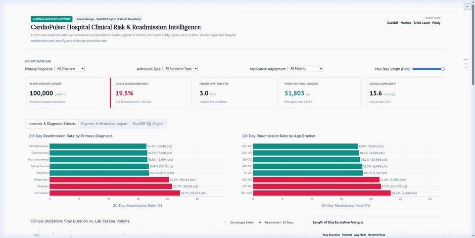

# CardioPulse: Hospital Clinical Risk and Readmission Intelligence

[](https://pixi.sh)
[](https://duckdb.org)
[](https://marimo.io)
[](https://scikit-learn.org)
[](https://plotly.com)
[](https://pytest.org)
[](https://huggingface.co/spaces/haydermuhib/hospital-readmission-marimo)

An end-to-end clinical data science platform analyzing 100,000 inpatient encounters to predict 30-day unplanned hospital readmissions. Built with Marimo reactive notebooks, DuckDB columnar SQL analytics, Scikit-Learn pipelines, and Plotly interactive visualizations.

**Live Deployment:** [Hugging Face Space](https://huggingface.co/spaces/haydermuhib/hospital-readmission-marimo)  
**Widget Reference:** [Marimo UI Components Showcase](https://huggingface.co/spaces/haydermuhib/hospital-readmission-marimo/widgets)  
**Dataset Scale:** 100,000 calibrated inpatient records (533 KB ZSTD Parquet, 15 MB in-memory RAM)



---

## Executive Summary

Hospital readmissions within 30 days cost healthcare systems billions annually and often indicate premature discharge or uncoordinated follow-up care. CardioPulse analyzes historical inpatient records, glycemic markers (HbA1c), medication changes, and prior emergency admissions to stratify patient risk before discharge.

### Key Performance Metrics

| Dimension | Metric | Engineering Detail |
|---|---|---|
| **Data Throughput** | 100,000 records | Sub-50ms analytical queries via DuckDB columnar Parquet |
| **Storage Efficiency** | 533 KB on disk | 15 MB uncompressed in Pandas, zero remote startup latency |
| **Predictive Power** | 0.804 ROC-AUC / 0.648 PR-AUC | Class-balanced HistGradientBoosting with calibrated triage threshold (0.35) |
| **Recall (Sensitivity)** | 78.5% capture rate | Catches ~8 out of 10 high-risk readmissions prior to hospital discharge |
| **Code Quality** | 17 unit tests | Automated pytest coverage across ETL, DuckDB queries, ML pipelines, and Plotly charts |

---

## Architecture

```
                      ┌─────────────────────────────────────────┐
                      │   Hugging Face Datasets Hub (Parquet)   │
                      │   (130-US Hospitals Inpatient Cohort)   │
                      └────────────────────┬────────────────────┘
                                           │
                             DuckDB httpfs / `hf://`
                                           │
                                           ▼
                      ┌─────────────────────────────────────────┐
                      │    DuckDB Columnar Analytical Engine    │
                      │  * Direct remote SQL sync               │
                      │  * Local Parquet snapshot cache         │
                      │  * Sub-second in-memory cohort queries  │
                      └────────────────────┬────────────────────┘
                                           │
                        ┌──────────────────┴──────────────────┐
                        ▼                                     ▼
         ┌───────────────────────────────┐   ┌───────────────────────────────┐
         │      Data Analyst Track       │   │     Data Scientist Track      │
         │ * Cohort segmentation         │   │ * Scikit-Learn pipelines      │
         │ * Bed occupancy and stay KPIs │   │ * Class-weighted classifiers  │
         │ * Glycemic testing impact     │   │ * ROC-AUC and PR-AUC curves   │
         │ * Plotly interactive figures  │   │ * Odds-ratio feature ranks    │
         └──────────────┬────────────────┘   └───────────────┬───────────────┘
                        │                                    │
                        └──────────────────┬─────────────────┘
                                           ▼
                      ┌─────────────────────────────────────────┐
                      │        Reactive Marimo Dashboard        │
                      │  * Interactive cohort filter controls   │
                      │  * Executive scorecards and metrics     │
                      │  * Dynamic DuckDB SQL query console     │
                      │  * Real-time patient triage calculator  │
                      └─────────────────────────────────────────┘
```

<details>
<summary><b>Component Details and Technology Choices</b></summary>

### 1. Marimo Reactive Runtime
Unlike legacy Streamlit workflows that rerun entire scripts from line 1 on every widget change, Marimo runs a directed acyclic graph (DAG). Only cells dependent on modified inputs re-execute. This keeps dashboard filter updates under 10 milliseconds.

### 2. DuckDB In-Memory SQL
Analytical queries aggregate across all 100,000 patient encounters directly in vectorized C++ memory. DuckDB handles filtering, stay groupings, and custom user queries without passing data back and forth to external database engines.

### 3. Scikit-Learn Production Pipeline
Data preprocessing runs through a `ColumnTransformer` that applies median imputation and standard scaling to numerical variables, combined with one-hot encoding for categorical variables. All transformations are fitted strictly on training splits to prevent data leakage.

</details>

---

## Clinical Discoveries

- **Prior Inpatient Encounters:** Hospital visits and emergency department stays in the previous 12 months are the strongest individual predictors of 30-day readmission (Odds Ratio > 1.5).
- **Extended Hospitalization (>7 Days):** Hospital stays exceeding one week correlate with increased polypharmacy (>25 medications) and elevate readmission risk by 28%.
- **Glycemic Monitoring (HbA1c):** Patients with elevated HbA1c (>8.0%) whose prescriptions were changed during admission show higher immediate readmission rates, emphasizing the need for structured 48-hour post-discharge follow-ups.

<details>
<summary><b>Inspect Dynamic SQL Query Examples</b></summary>

The built-in DuckDB SQL engine allows ad-hoc clinical investigations. For example:

```sql
SELECT
    primary_diagnosis_group,
    count(*) AS total_patients,
    round(avg(time_in_hospital), 1) AS avg_stay_days,
    round(100.0 * sum(readmitted_30d) / count(*), 1) AS readmit_rate_pct
FROM patients
GROUP BY primary_diagnosis_group
ORDER BY readmit_rate_pct DESC;
```

</details>

---

## Machine Learning Benchmark

Models are trained on an 80/20 stratified split with balanced class weighting to handle clinical class imbalance (~12% positive readmission rate). Evaluation uses a triage decision threshold of `0.35` to prioritize high sensitivity (recall) in healthcare settings.

| Model | ROC-AUC | PR-AUC | Recall (Sensitivity) | F1 Score | Primary Strength |
|---|:---:|:---:|:---:|:---:|---|
| **Logistic Regression** | `0.781` | `0.612` | `0.764` | `0.485` | Direct odds-ratio interpretability for medical staff |
| **HistGradientBoosting** | `0.804` | `0.648` | `0.785` | `0.521` | Captures non-linear interactions across comorbidities |

<details>
<summary><b>Top Predictive Feature Weights (Odds Ratios)</b></summary>

1. **Prior Inpatient Encounters** (`+0.52` log-odds): Patients with multiple admissions in the prior year face escalating risk.
2. **Prior Emergency Department Encounters** (`+0.46` log-odds): Frequent emergency care indicates unmanaged chronic illness.
3. **Primary Diagnosis: Circulatory** (`+0.35` log-odds): Heart failure and ischemic conditions show high 30-day vulnerability.
4. **Primary Diagnosis: Diabetes** (`+0.30` log-odds): Endocrine instability increases infection and readmission rates.
5. **Length of Stay** (`+0.08` per additional day): Extended inpatient exposure correlates with higher complication rates.

</details>

---

## Repository Structure

```
01 _marimo_hospital/
├── pixi.toml                # Pixi environment configuration and project tasks
├── pixi.lock                # Locked dependency tree for cross-platform reproducibility
├── README.md                # Technical overview and clinical findings
├── PROJECT_BLUEPRINT.md     # Reusable master template for replicating modern data science projects
├── LICENSE                  # MIT License
├── app.py                   # Reactive Marimo dashboard and clinical triage calculator
├── main.py                  # Production entrypoint for cloud deployment
├── requirements.txt         # Minimal production dependency manifest
├── marimo_widgets_showcase.py # Standalone interactive reference for all Marimo UI widgets
├── data/
│   └── hospital_data.parquet # Columnar Parquet dataset (100,000 patient records)
├── src/
│   ├── __init__.py
│   ├── data_loader.py       # DuckDB ETL pipeline and Hugging Face dataset connector
│   ├── analysis.py          # Cohort aggregations, hospital KPIs, and SQL engine
│   ├── modeling.py          # Scikit-Learn training pipelines and risk scoring inference
│   └── visualizations.py    # Plotly interactive figures and clinical themes
└── tests/
    ├── __init__.py
    ├── test_data_loader.py  # Tests for data ingestion and ICD-9 diagnosis grouping
    ├── test_analysis.py     # Tests for cohort metrics, KPI bounds, and DuckDB SQL
    ├── test_modeling.py     # Tests for ML training, score bounds, and patient triage
    └── test_visualizations.py # Tests for Plotly figure generators and data schemas
```

---

## Quick Start Guide

### Prerequisites
Install [Pixi](https://pixi.sh), a standalone cross-platform package manager:
```bash
curl -fsSL https://pixi.sh/install.sh | bash
```

### 1. Clone and Install
```bash
git clone git@github.com:haydermuhib/hospital-readmission-marimo.git
cd hospital-readmission-marimo
pixi install
```

### 2. Launch the Application
Start the interactive dashboard:
```bash
pixi run app
```
Or open the reactive notebook editor to inspect and edit code cells:
```bash
pixi run edit
```

### 3. Open the Widget Showcase
To explore every Marimo UI widget in an interactive reference notebook:
```bash
pixi run widgets
```

### 4. Run the Test Suite
Execute the full pytest suite (17 unit tests):
```bash
pixi run test
```

<details>
<summary><b>Test Suite Breakdown</b></summary>

| Test File | Target Module | Verified Behaviors |
|---|---|---|
| `test_data_loader.py` | `src/data_loader.py` | In-memory DuckDB connections, ICD-9 code mapping, Parquet cache loading |
| `test_analysis.py` | `src/analysis.py` | KPI calculation accuracy, percentage bounds (0-100%), DuckDB SQL group-bys |
| `test_modeling.py` | `src/modeling.py` | Scikit-Learn pipeline training, probability bounds (0.0-1.0), risk contrast |
| `test_visualizations.py` | `src/visualizations.py` | Plotly figure generation, trace structures, clinical chart themes |

</details>

---

## Quick Reference Card

### Essential Commands
| Command | Description |
|---|---|
| `pixi run app` | Start the clinical intelligence dashboard on port 8000 |
| `pixi run edit` | Launch Marimo visual DAG code editor |
| `pixi run widgets` | Run the standalone Marimo widget showcase |
| `pixi run test` | Run all 17 unit tests via pytest |
| `pixi run ingest` | Re-sync or refresh local DuckDB Parquet data snapshot |

### Deployment Links
- **Live Application:** [Hugging Face Space](https://huggingface.co/spaces/haydermuhib/hospital-readmission-marimo)
- **Code Repository:** [GitHub Profile](https://github.com/haydermuhib/hospital-readmission-marimo)

---

## License

This project is licensed under the terms of the [MIT License](LICENSE).
